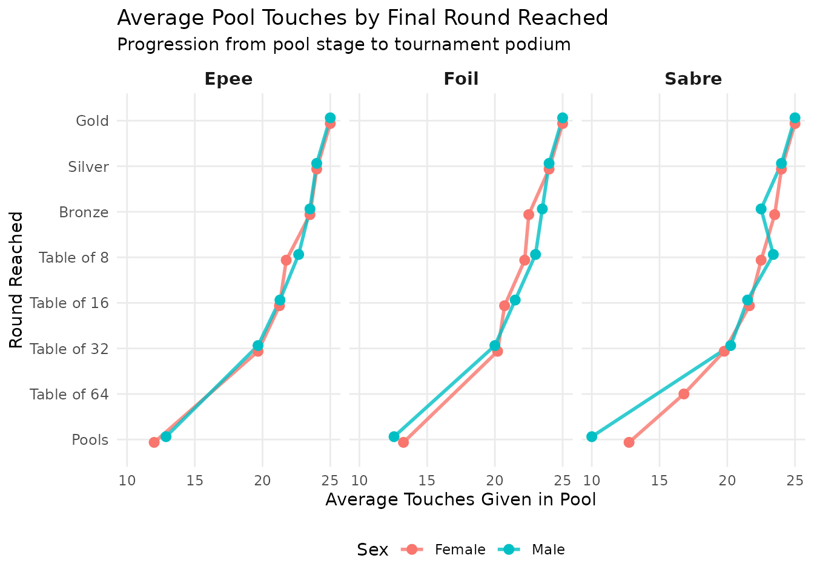
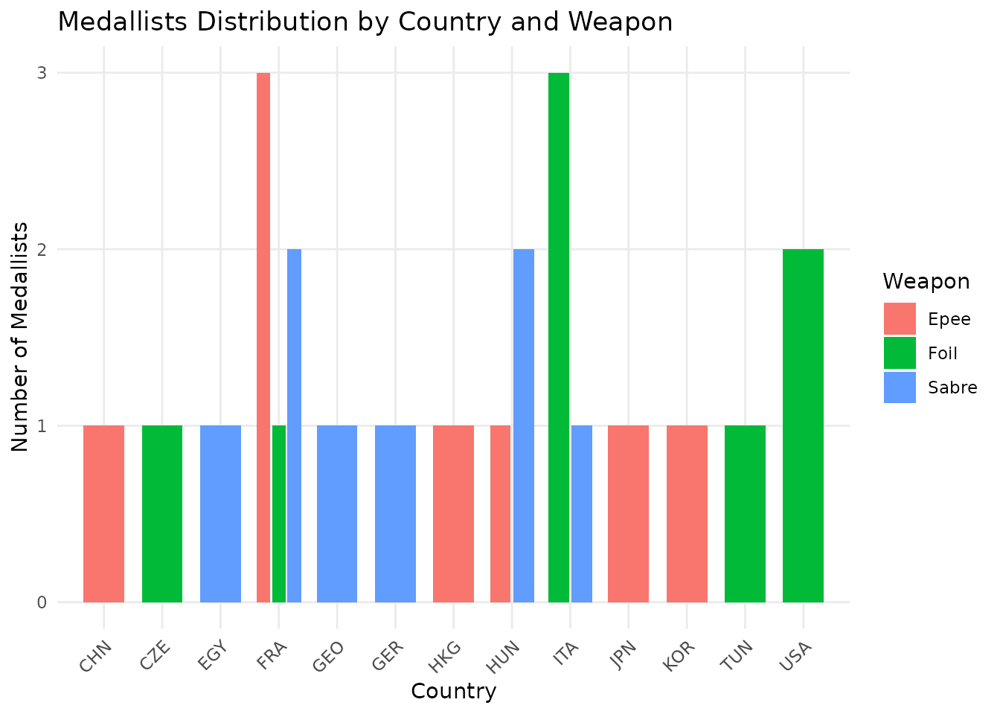

# Introduction to fencingR

``` r

library(fencingR)
```

## Exploring the Dataset

The package includes a built-in dataset, `fencing_wc2026`, which
contains pool phase performance metrics and tournament progression
records for a sample of athletes.

The package includes a built-in dataset, fencing_wc2026, which contains
pool phase performance metrics and tournament progression records for a
sample of athletes.

Let’s take a quick look at the structure of the dataset:

``` r

utils::head(fencing_wc2026, 5)
#>                 fencer country    sex weapon passed_pool touches_given
#> 1       Larissa Eifler     GER Female  sabre         yes            25
#> 2          Sara Balzer     FRA Female  sabre         yes            24
#> 3         Toscane Tori     FRA Female  sabre         yes            23
#> 4 Sugar Katinka Battai     HUN Female  sabre         yes            24
#> 5        Sarah Noutcha     FRA Female  sabre         yes            22
#>   touches_received pool_index pool_win_rate round_reached
#> 1               12         13          0.83          Gold
#> 2               15          9          0.67        Silver
#> 3               16          7          0.67        Bronze
#> 4               14         10          0.83        Bronze
#> 5               17          5          0.67    Table of 8
```

Each row represents an individual athlete and tracks critical
performance indicators such as:

- **`touches_given` & `touches_received`**: Raw offensive and defensive
  volumes during the pool stage.

- **`pool_index`**: The net touch indicator ($`TS - TR`$).

- **`pool_win_rate`**: The victory ratio in pool bouts.

- **`round_reached`**: The highest tournament progression stage
  achieved.

## 1. Analyzing National Delegation Performance: `country_pool_index()`

To evaluate structural dominance and talent depth across national
federations, we can calculate the average pool win rate per country. To
prevent statistical distortion from isolated individual entries, the
function incorporates a sample size threshold (`min_fencers = 12` by
default, ensuring multi-entry representation across sexes and weapon
types).

``` r

# Calculate average pool win rates for delegations meeting the threshold
country_rankings <- country_pool_index(fencing_wc2026, min_fencers = 12)

country_rankings
#> # A tibble: 4 × 2
#>   country average_pool_win_rate
#>   <chr>                   <dbl>
#> 1 FRA                     0.631
#> 2 ITA                     0.599
#> 3 USA                     0.591
#> 4 KOR                     0.579
```

## 2. Visualizing Pool Efficiency vs. Tournament Progression: `touchesgiven_effect()`

In competitive fencing, pool stage performance directly dictates the
initial seeding for direct elimination brackets. Fencers who dominate
pools secure more favorable seeds, bypassing early encounters with top
contenders.

The
[`touchesgiven_effect()`](https://paulinaguers.github.io/fencingR/reference/touchesgiven_effect.md)
function investigates this dynamic by plotting average pool touches
against the final round reached, faceted by weapon and stratified by
sex:

``` r

touchesgiven_effect(fencing_wc2026)
```



## 3. Extracting and Visualizing Medallists

Understanding who reaches the podium is crucial for competitive
benchmarking.

### Filtering Podium Athletes: `get_medallists()`

We can use
[`get_medallists()`](https://paulinaguers.github.io/fencingR/reference/get_medallists.md)
to isolate athletes who reached the podium (Gold, Silver, and Bronze
medals) and extract their key identification attributes:

``` r

podium_athletes <- get_medallists(fencing_wc2026)

podium_athletes
#> # A tibble: 24 × 5
#> # Groups:   weapon, sex [6]
#>    fencer                    country sex    weapon round_reached
#>    <chr>                     <chr>   <chr>  <chr>  <chr>        
#>  1 Larissa Eifler            GER     Female sabre  Gold         
#>  2 Sara Balzer               FRA     Female sabre  Silver       
#>  3 Toscane Tori              FRA     Female sabre  Bronze       
#>  4 Sugar Katinka Battai      HUN     Female sabre  Bronze       
#>  5 Martina Favaretto         ITA     Female foil   Gold         
#>  6 Alice Volpi               ITA     Female foil   Silver       
#>  7 Lee Kiefer                USA     Female foil   Bronze       
#>  8 Ines Boubakri             TUN     Female foil   Bronze       
#>  9 Sera Song                 KOR     Female epee   Gold         
#> 10 Marie-Florence Candassamy FRA     Female epee   Silver       
#> # ℹ 14 more rows
```

### Plotting Medallists Distribution: `plot_medallists_by_country()`

With the extracted subset, we can visualize the distribution of
medallists across countries, broken down by weapon discipline

``` r

plot_medallists_by_country(fencing_wc2026)
```



## Summary

`fencingR` streamlines the pipeline from raw tournament metrics to
high-level tactical insights. Whether you are studying seeding
correlations via pool touches or mapping global podium performance, the
package provides a clean, tidyverse-native framework for fencing
analytics.
