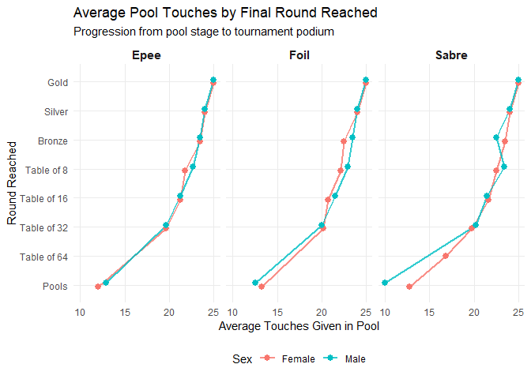
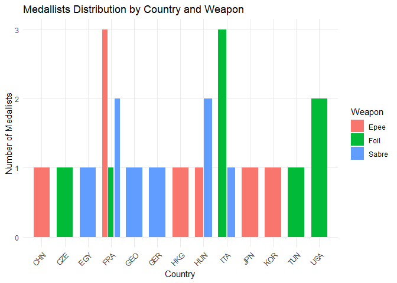

## fencingR

**fencingR** provides a tidyverse-native framework for processing,
analyzing, and visualizing competitive fencing tournament data. From
pool stage efficiency metrics to direct elimination seeding gradients
and national delegation benchmarking, the package streamlines
quantitative performance analysis across all three weapons (*Epee*,
*Foil*, and *Sabre*).Installation

## Example Installation

You can install the development version of fencingR from
[GitHub](https://github.com/) with:

``` r

# install.packages("pak")
pak::pak("paulinaguers/fencingR")
```

## Built-in Dataset:

The package includes `fencing_wc2026`, a curated dataset of 151 athlete
records from a World Championship scenario, capturing pool phase volume,
win rates, and final tournament progression.

``` r

library(fencingR)

#to give it a look
utils::head(fencing_wc2026, 5)
#>                 fencer country    sex weapon passed_pool touches_given
#> 1       Larissa Eifler     GER Female  sabre         yes            25
#> 2          Sara Balzer     FRA Female  sabre         yes            24
#> 3         Toscane Tori     FRA Female  sabre         yes            23
#> 4 Sugar Katinka Battai     HUN Female  sabre         yes            24
#> 5        Sarah Noutcha     FRA Female  sabre         yes            22
#>   touches_received pool_index pool_win_rate round_reached
#> 1               12         13          0.83          Gold
#> 2               15          9          0.67        Silver
#> 3               16          7          0.67        Bronze
#> 4               14         10          0.83        Bronze
#> 5               17          5          0.67    Table of 8
```

- **`touches_given` & `touches_received`**: Offensive and defensive
  touch volumes during the pool stage.

- **`pool_index`**: Net touch indicator ($`TS - TR`$).

- **`pool_win_rate`**: Proportion of pool bouts won.

- **`round_reached`**: Final tournament stage achieved (`Pools` through
  `Gold`).

## Quick Workflow

### 1. National Delegation Benchmarking

Evaluate depth and average pool efficiency across countries while
filtering out small sample sizes (`min_fencers = 12` by default):

``` r

country_pool_index(fencing_wc2026, min_fencers = 12)
#> # A tibble: 4 × 2
#>   country average_pool_win_rate
#>   <chr>                   <dbl>
#> 1 FRA                     0.631
#> 2 ITA                     0.599
#> 3 USA                     0.591
#> 4 KOR                     0.579
```

### 2. Pool Efficiency vs. Tournament Progression

Analyze how offensive output during pools translates into direct
elimination seeding and podium finishes across weapons and sexes:

``` r

touchesgiven_effect(fencing_wc2026)
```



### 3. Podium Extraction & Distribution

Isolate medalists (`Gold`, `Silver`, `Bronze`) and visualize medal
counts by national federation and weapon:

``` r

podium <- get_medallists(fencing_wc2026)
utils::head(podium, 6)
#> # A tibble: 6 × 5
#> # Groups:   weapon, sex [2]
#>   fencer               country sex    weapon round_reached
#>   <chr>                <chr>   <chr>  <chr>  <chr>        
#> 1 Larissa Eifler       GER     Female sabre  Gold         
#> 2 Sara Balzer          FRA     Female sabre  Silver       
#> 3 Toscane Tori         FRA     Female sabre  Bronze       
#> 4 Sugar Katinka Battai HUN     Female sabre  Bronze       
#> 5 Martina Favaretto    ITA     Female foil   Gold         
#> 6 Alice Volpi          ITA     Female foil   Silver

plot_medallists_by_country(fencing_wc2026)
```



## Learn More

For a comprehensive walkthrough of the analytical methodology and all
package functions, read the introductory vignette:

``` r

vignette("Introduction to fencingR", package = "fencingR")
```
